# ADFGVX-Kryptogramme

Sammlung der 22 verschlüsselten Funksprüche aus dem Cipherbrain-Artikel sowie der belegten Schlüssel und Originalabbildungen. Die Transkriptionen stehen in [`data/corpus.py`](data/corpus.py); die Schlüsselkennungen in [`data/keys.py`](data/keys.py).

## Zeichenerklärung

- Geheimtexte bestehen aus den Symbolen `A D F G V X`; Leerzeichen trennen hier nur Fünfergruppen.
- `-` kennzeichnet ein unleserliches Zeichen; Kleinbuchstaben markieren unsichere Lesungen.
- Ein nicht zugeordneter Schlüssel oder fehlender Scan ist ausdrücklich als solcher markiert.

## Schlüsselmaterial

Die Schlüsselkennung bezeichnet den dokumentierten Zeitraum. `Permutation` ist die Spaltenrangfolge; `Quadrat` ist das 6×6-Substitutionsquadrat, zeilenweise notiert. `-` steht für eine unbekannte Zelle. Die vollständige veröffentlichte Schlüsselliste liegt auch in [`docs/adfgvx_keys.pdf`](docs/adfgvx_keys.pdf).

### Nov1-3

- Permutation: `3, 16, 4, 15, 7, 12, 18, 6, 17, 8, 19, 1, 13, 10, 2, 14, 11, 9, 5`
- Quadrat: `UILOF9RCZVSX02G7QTD8WNB5JMHEKPY41A36`

### Nov4-6

- Permutation: `7, 10, 8, 14, 3, 11, 16, 1, 6, 13, 4, 9, 15, 5, 12, 17, 2`
- Quadrat: `17WHFLJ5D2UPEXKVZ9O0Q3Y6R8ABGITCMS4N`

### Nov7-9

- Permutation: `6, 12, 7, 15, 1, 11, 16, 5, 8, 14, 3, 18, 9, 13, 2, 17, 20, 10, 19, 4`
- Quadrat: `PRMYUW3LZGES8C71QOV29ITB40-KXH-AJNDF`

### Nov10-12

- Permutation: `9, 12, 7, 11, 3, 8, 16, 6, 14, 2, 10, 15, 5, 13, 1, 4`
- Quadrat: `4ARUT1OIFSKN3-BZPVLD-JMXCWHQ2E-G0-Y-`

### Nov13-15a

- Permutation: `13, 8, 6, 16, 7, 18, 1, 14, 9, 20, 10, 15, 17, 2, 3, 11, 5, 19, 4, 12`
- Quadrat: `JZLH-R--S-T-MKDWU-V-B-P--FAO-GIX-CNE`

### Nov13-15b

- Permutation: `4, 11, 5, 14, 9, 7, 16, 1, 12, 15, 6, 10, 3, 13, 8, 2`
- Quadrat: `H--BMUF15PX0DJLR---S6VONKZ-AWITEGC-`

### Nov22-24

- Permutation: `6, 12, 16, 7, 14, 22, 11, 18, 1, 15, 8, 10, 20, 2, 13, 21, 3, 17, 19, 5, 9, 4`
- Quadrat: `QNZ72XS4C0IJY3RBEKL9FD6GMTHUVWA5O8P1`

## Nachrichten

### Seite 73

**Schlüssel:** nicht sicher zugeordnet

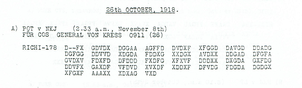

```text
D-FX GDVDX DGGAA AGFFD DVDXF XFGGD DAVGD DDADG
DGFGG DDVVD XDGDA FDDXG XXDGX AVDXX DDGAD DFGFA
GVDXV FDXFD DFDDD FXDFG XFXVF DDDXX DXGDA GXFDG
DDVFX GAXDF VFDVD XVXDF XDDXF DFVDG FDGDA DGDGX
XFGXF AAAXX XDXAG VXD
```

### Seite 100

**Schlüssel:** `Nov1-3`

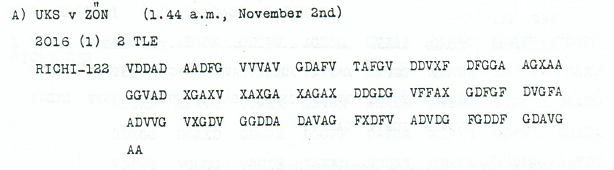

```text
VDDAD AADFG VVVAV GDAFV VAFGV DDVXF DFGGA AGXAA
GGVAD XGAXV XAXGA XAGAX DDGDG VFFAX GDFGF DVGFA
ADVVG VXGDV GGDDA DAVAG FXDFV ADVDG DGFGD DFGDA
VGAA
```

### Seite 105

**Schlüssel:** `Nov1-3`

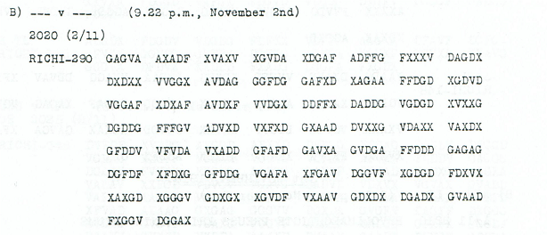

```text
GAGVA AXADF XVAXV XGVDA XDGAF ADFFG FXXXV DAGDX
DXDXX VVGGX AVDAG GGFDG GAFXD XAGAA FFDGD XGDVD
VGGAF XDXAF AVDXF VVDGX DDFFX DADDG VGDGD XVXXG
DGDDG FFFGV ADVXD VXFXD GXAAD DVXXG VDAXX VAXDX
GFDDV VFVDA VXADD GFAFD GAVXA GVDGA FFDDD GAGAG
DGFDF XFDXG GFDDG VGAFA XFGAV FGGVF XGXAD FDXVX
XAXGD XGGGV GDXGX XGVDF VXAAV GDXDX DGADX GVAAD
FXGGV DGGAX
```

### Seite 109

**Schlüssel:** `Nov1-3`

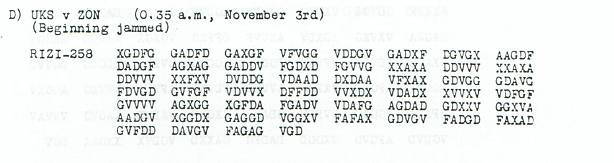

```text
XGDFG GADFD GAXGF VFVGG VDDGV GADXF DGVGX AAGDF
DADGF AGXAG GADDV FGDXD FGVVG XXAXA DDVVV XXAXA
DDVVV XXFXV DVDDG VDAAD DXDAA VFXAX GDVGG GDAVG
FDVGD GVFGF VDVVX DFFDD VVXDX VDADX XVVXV VDFGF
GVVVV AGXGG XGFDA FGADV VDAFG AGDAD GDXXV GGXVA
AADGV XGGDX GAGGD VGGXV FAFAX GDVGV FADGD FAXAD
GVFDD DAVGV FAGAG VGD
```

### Seite 132

**Schlüssel:** `Nov4-6`

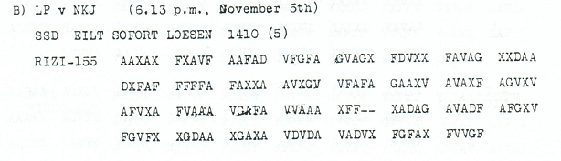

```text
AAXAX FXAVF AAFAD VFGFA GVAGX FDVXX FAVAG XXDAA
DXFAF FFFFA FAXXA AVXGV VFAFA GAAXV AVAXF AGVXV
AFVXA FVAAA VGAFA VVAAA XFF- XADAG AVADF AFGXV
FGVFX XGDAA XGAXA VDVDA VADVX FGFAX FVVGF
```

### Seite 146

**Schlüssel:** `Nov4-6`

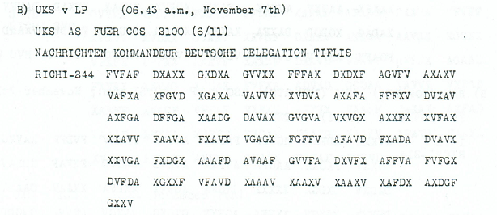

```text
FVFAF DXAXX GXDXA GVVXX FFFAX DXDXF AGVFV AXAXV
VAFXA XFGVD XGAXA VAVVX XVDVA AXAFA FFFXV DVXAV
AXFGA DFFGA XAADG DAVAX GVGVA VXVGX AXXFX XVFAX
XXAVV FAAVA FXAVX VGAGX FGFFV AFAVD FXADA DVAVX
XXVGA FXDGX AAAFD AVAAF GVVFA DXVFX AFFVA FVFGX
DVFDA XGXXF VFAVD XAAAV XAAXV XAAXV XAFDX AXDGF
GXXV
```

### Seite 152

**Schlüssel:** nicht sicher zugeordnet

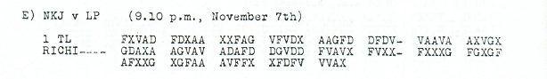

```text
FXVAD FDXAA XXFAG VFVDX AAGFD DFDVv VAAVA AXVGX
GDAXA AGVAV ADAFD DGVDD FVAVX FVXXv FXXXG FGXGF
AFXXG XGFAA AVFFX XFDFV VVAX
```

### Seite 153a

**Schlüssel:** `Nov13-15a`

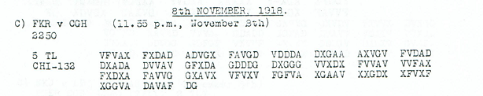

```text
VFVAX FXDAD ADVGX FAVGD VDDDA DXGAA AXVGV FVDAD
DXADA DVVAV GFXDA GDDDG DXGGG VVXDX FVVAV VVFAX
FXDXA FAVVG GXAVX VFVXV FGFVA XGAAV XXGDX XFVXF
XGGVA DAVAF DG
```

### Seite 153b

**Schlüssel:** nicht sicher zugeordnet

*Für diese Transkription ist im Artikel kein separates Originalbild enthalten.*

```text
AXVAA ----- ----- ----- DDAFF VAXAG GADAF DXAXX
XVDGD XVXFF GXFAV VAADA GXXXA XDDGV AVAXV AXAAV
VXVAV GXAXX FGXXF AAAFX VADFD XVF
```

### Seite 158

**Schlüssel:** nicht sicher zugeordnet

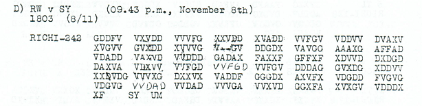

```text
GDDFV VXVDD VVVFG XXVDD XVADD VVFGV VDDVV DVAXV
XVGVV GVXDD XVVVG X-GV DDGDX VAVGG AAAXG AFFAD
VDADD VAXVD VVDDD GADAX FAXXF GFFXF XDVVD DXDGD
DAXVA VXXVV VVFGD VVFGD VVFGV DDDAG GVXDG XDDVV
XXVDG VVVXG DXXVX VADDF GGGDX AXVFX VDGDD FVGVG
VDGVG VVDAD VVDAD VVVGA VVXVD GGXFA XVXGV VDDDX
XF
```

### Seite 164a

**Schlüssel:** `Nov7-9`

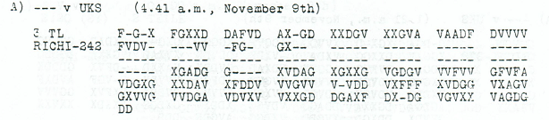

```text
F-G-X FGXXD DAFVD AX-GD XXDGV XXGVA VAADF DVVVV
FVDV- --VV -FG-- GX-- ----- ----- ----- -----
----- XGADG G--- XVDAG XGXXG VGDGV VVFVV GFVFA
VDGXG XXDAV XFDDV VVGVV V-VDD VXFFF XVDGG VXAGV
GXVVG VVDGA VDVXV VXXGD DGAXF DX-DG VGVXX VAGDG
DD
```

### Seite 164b

**Schlüssel:** `Nov7-9`

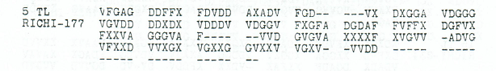

```text
VFGAG DDFFX FDVDD AXADV FGD-- --VX DXGGA VDGGG
VGVDD DDXDX VDDDV VDGGV FXGFA DGDAF FVFFX DGFVX
FXXVA GGGVA F--- --VVD GVGVA XXXXF XVGVV -ADVG
VFXXD VVXGX VGXXG GVXXV VGXV- -VVDD ----- -----
----- ----- ----- -
```

### Seite 170

**Schlüssel:** nicht sicher zugeordnet

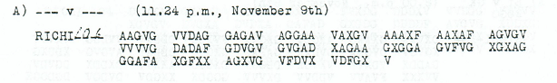

```text
AAGVG VVDAG GAGAV AGGAA VAXGV AAAXF AAXAF AGVGV
VVVVG DADAF GDVGV GVGAD XAGAA GXGGA GVFVG XGXAG
GGAFA XGFXX AGXVG VFDVX VDFGX V
```

### Seite 171

**Schlüssel:** `Nov7-9`

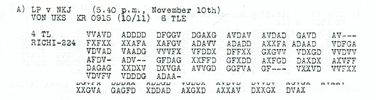

```text
AAVGF DDADX XDAAV GXAGX AFVAA ADDXD AXDDD DGDDD
AAGDV VGVXD GDVDV GVVVV VVGXV VDFVG GVVDV DDVGX
DVXVX XGAXA -DDDX XDDXD XXAXD VDXVX ADAGD AGXGA
ADDVV XGXDD GDVFA --FFA XGDDX G-VVD VVXDF GVVDG
VGVAG GXVXV VVVVD VXVGG VGGXG GVVGD GXXVG GVVXX
DXDDG VDVVV DDDGG XVVGD DXXDD GGVDX XVVVD GGXGV
DGVFA DDDAX ADDGD VGDDX XVDVD DVVDV XGVGX XVXXV
XXGVA GAGFD XDDAD AXGXD AXXAV DXXGX DVAX
```

### Seite 176a

**Schlüssel:** `Nov10-12`

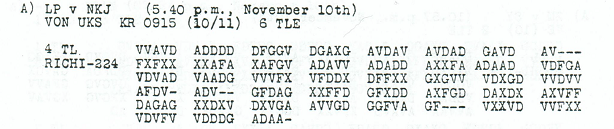

```text
VVAVD ADDDD DFGGV DGAXG AVDAV AVDAD GAVDA AVXXX
FXFXX XXAFA XAFGV ADAVV ADADD AXXFA ADAAD VDFGA
VDVAD VAADG VVVFX VFDDX DFFXX GXGVV VDXGD VVDVV
AFDVX ADVXX GFDAG XXFFD GFXDD AXFGD DAXDX AXVFF
DAGAG XXDXV DXVGA AVVGD GGFVA GFAXX VXXVD VVFXX
VDVFV VDDDG ADAA
```

### Seite 176b

**Schlüssel:** nicht sicher zugeordnet

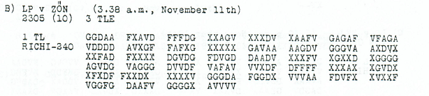

```text
GGDAA FXAVD FFFDG XXAGV XXXDV XAAFV GAGAF VFAGA
VDDDD AVXGF FAFXG XXXXX GAVAA AAGDV GGGVA AXDVX
XXFAD FXXXX DGVDG FDVGD DAADV XXXFV XGXXD XGGGG
AGVDG VAGGG DVVDF VAFAV VVXDF DFFFF XXXAX XGVDX
XFXDF FXXDX XXXXV GGGDA FGGDX VVVAA FDVFX XVXXF
VGGFG DAAFV GGGGX AVVVV
```

### Seite 215 (im Artikel ohne Seitenzahl)

**Schlüssel:** `Nov22-24`

*Für diese Transkription ist im Artikel kein separates Originalbild enthalten.*

```text
VGADA FAXAD XFAXF FVXDD XXXDX D-F-- DDAVF VGXDF
FXDGF VVVFA GXXXA FAGDD FAVDG VAVXF AFDXA FDGAD
VAFFV VFFAA XDGVV AVXXV GDFDF VVGDF AAFAV FVXGG
VFAAA XXDAV AVFFA DAFAA XAGGA DADVD FVVDF GAAVA
AXADV DAXVF DFGDF GV-FA -GDDA FGG-D VFFDX --VD
FAAAX XADGF FDFFX -VAA AAXXV XFXDF XGFDA VAADF
DDVVX XXF
```

### Seite 187

**Schlüssel:** `Nov13-15b`

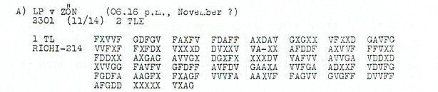

```text
FFVXV GVVXA XFAFA DAXVX GADDV VVAVV VXVFV GVAAX
VVADA DVFAD XGDDF GVAAD VAVGA VFDAF FFDFF AVAFV
DXFAF AAFXA FXXAG XXDXA DGFAX GFGAD XFGFF VAAXG
FADAA AFDXG VGAFX FXDXX ADADD FGADA GVAFA AGXGD
XGXAX VGGXF FDXAG XDAGX AXFAV FFVVV AAFAV FFVAA
ADFAG FAFDV DF
```

### Seite 187b

**Schlüssel:** nicht sicher zugeordnet

*Für diese Transkription ist im Artikel kein separates Originalbild enthalten.*

```text
AFAFF AXDVA VVVVF ADVFA GXGVX AGVAX AXGGA AAAAA
ADDVV XVGAG AGXVV FGAAF VVXGD GGAVG VFDVD VDDDV
DXFAD DDDAX ADVVG AAFFG XGXAG GDADF VFXDA DGDDG
GAAXD VDFAD FFDDX VADDV GD
```

### Seite 189

**Schlüssel:** nicht sicher zugeordnet

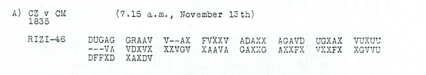

```text
DVGAG G-AAV V--AX FVXXV ADAXX AGAVD VGXAX VVXVV
--VA VDXVX XXVGV XAAVA GAXXG AXXFX VXXFX XGVVV
DFFXD XAXDV
```

### Seite 198

**Schlüssel:** nicht sicher zugeordnet

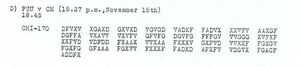

```text
DFVXV XGAXD GXVXD VGVGD VADXF FADVX XXVFV AAXGF
DGFFA VXAVV VXVFV GFVFG DGVFG FFFGV VVGGG XVFXF
XXFVD VDFDD FXAAX VVXAA FXXXV GXFVD VVXXF FGXGV
FGXFG GFAAA FGXVV FXXXF FADXD AFXFV VDGVX FGAGF
ADDFX
```

### Seite 217

**Schlüssel:** nicht sicher zugeordnet

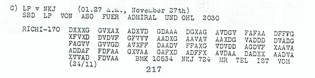

```text
DXXXG GVXAX ADXVD GDAAA DGXAG AVDGV FAFAA DFFFG
XFVXD DVDVF GFVVV AADXG AAVAV AAXDG VADDD DVADG
FAGVV GVVGD AVXFF DAADV FFAXG VDVDD AGDVF XAAVA
ADDAF FDFAA GXVAA GAFXD ADFFX AVDAA DADXX AADVA
XVVAD FDVAA
```

## Quellen

- [Cipherbrain: Unsolved ADFGVX messages from World War I](https://scienceblogs.de/klausis-krypto-kolumne/unsolved-adfxvx-messages-from-world-war-i/)
- [Originaltranskription und Abbildungen](docs/cipherbrain_pages/)
- [Weitere historische Unterlagen und Dokumentation](docs/)
